# HACK//TERMINAL

> 48-Hour Cybersecurity Hackathon Website

A retro military-themed hackathon website that mimics 1980s Unix terminal interfaces and classified military computer systems. Built with phosphor-green text, CRT effects, red alert accents, and military terminology for an immersive retro-computing aesthetic.


---

## Screenshots

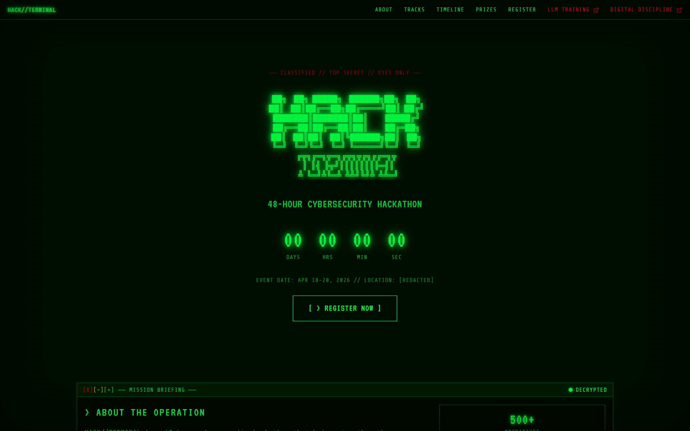

| Boot Sequence | Mobile |
|---|---|
| 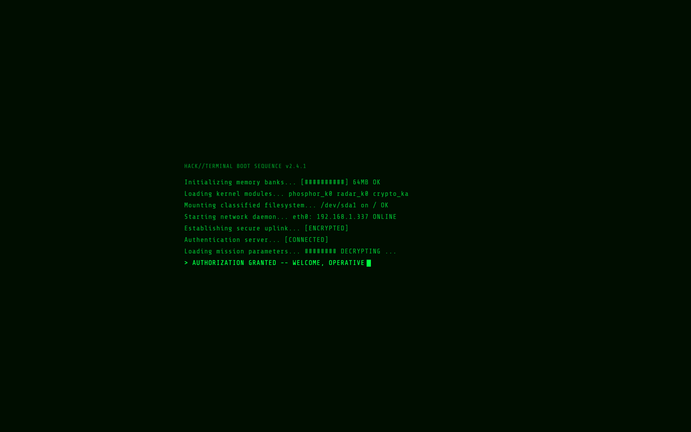 | 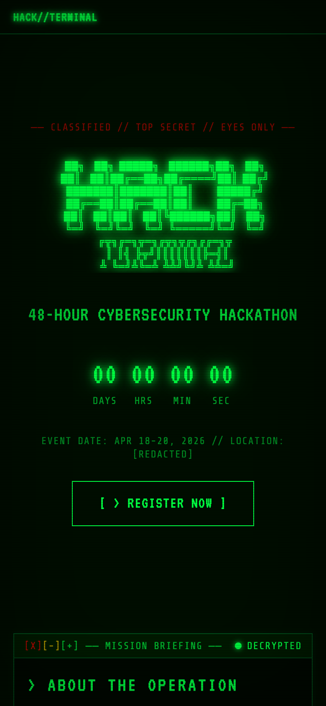 |

| Mission Tracks | Operation Timeline |
|---|---|
| 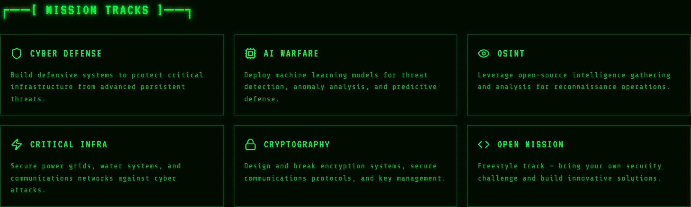 | 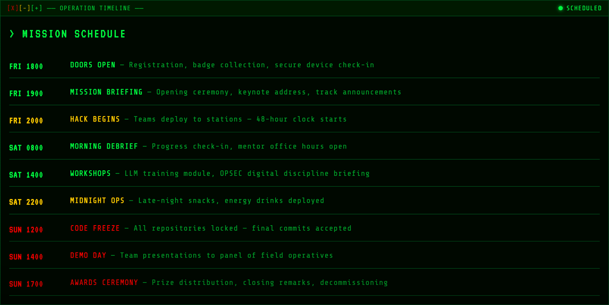 |

| Prize Manifest | Judge Panel |
|---|---|
| 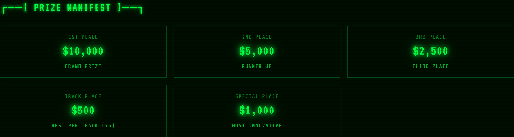 | 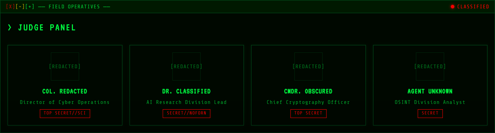 |

| FAQ | Registration |
|---|---|
| 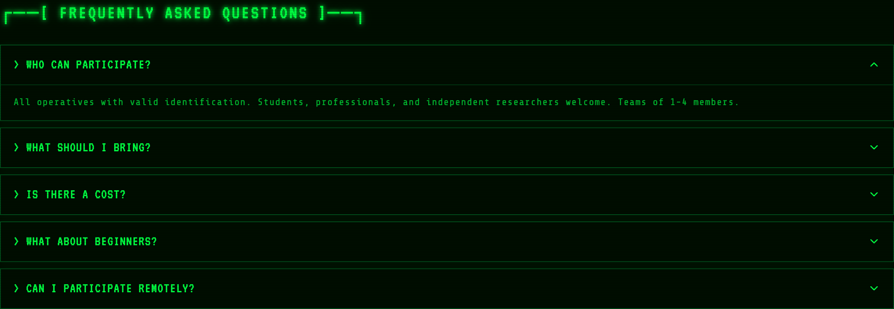 | 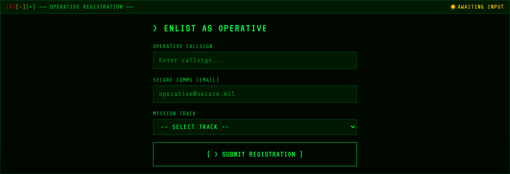 |

| LLM Fundamentals | Digital Discipline |
|---|---|
| 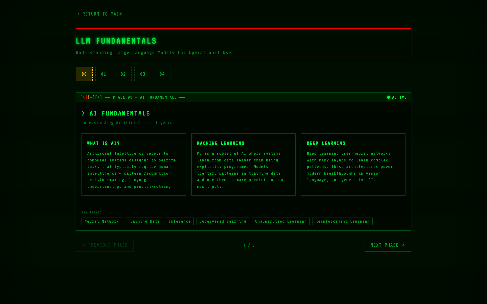 | 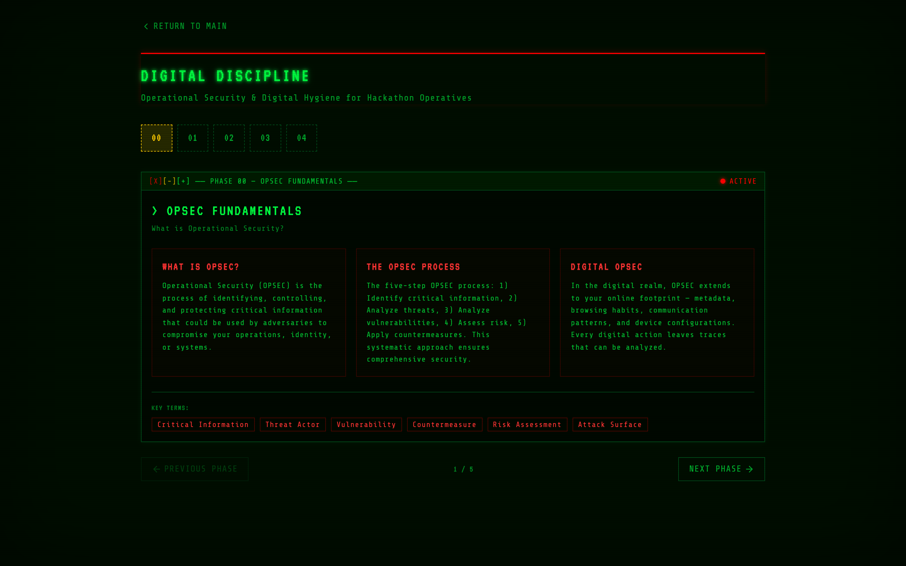 |

<details>
<summary>Full landing page &amp; 404</summary>

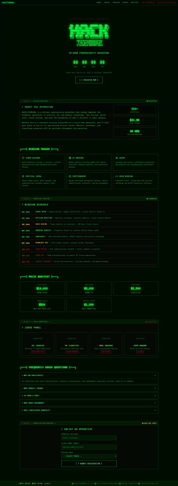

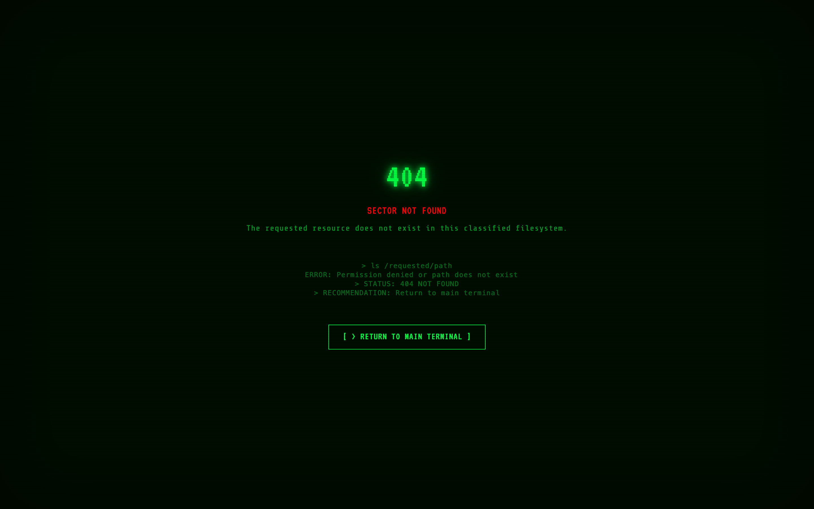

</details>

---

## Quick Start

```bash
# Install dependencies
npm install

# Start dev server
npm run dev

# Build for production
npm run build

# Preview production build
npm run preview
```

---

## Pages

### `/` — Home (Landing Page)

- **Boot Sequence** — Animated BIOS-style startup with typewriter effect
- **Hero** — ASCII art logo, live countdown timer to event date (Apr 18, 2026)
- **Mission Briefing** — About section with stats (500+ operatives, $21.5K prizes, 48 hrs)
- **Mission Tracks** — 6 tracks: Cyber Defense, AI Warfare, OSINT, Critical Infra, Cryptography, Open Mission
- **Operation Timeline** — Color-coded 3-day schedule (green/amber/red phases)
- **Prize Manifest** — $10K grand prize + track-specific awards
- **Judge Panel** — Redacted operative cards with security clearance badges
- **FAQ** — Accordion-style terminal Q&A
- **Registration** — Operative callsign, secure comms (email), and track selection form
- **Footer** — Live system clock, status indicators, scrolling marquee ticker

### `/llm-education` — LLM Fundamentals

5-phase educational module on Large Language Models:

| Phase | Topic |
|-------|-------|
| 00 | AI Fundamentals |
| 01 | LLM Basics |
| 02 | Capabilities & Use Cases |
| 03 | Limitations & Risks |
| 04 | Operational Applications |

### `/digital-discipline` — Digital Discipline (OPSEC)

5-phase operational security training module:

| Phase | Topic |
|-------|-------|
| 00 | OPSEC Fundamentals |
| 01 | Threat Landscape |
| 02 | Secure Practices |
| 03 | Operational Discipline |
| 04 | Incident Response |

---

## Design System

### Color Palette

| Color | Hex | Usage |
|-------|-----|-------|
| Phosphor Green | `#00ff41` | Primary text, borders, glows |
| Phosphor Dim | `#00aa2b` | Secondary text, inactive states |
| Phosphor Faint | `#004d1a` | Subtle borders, panel backgrounds |
| Alert Red | `#ff0000` | Warnings, critical alerts, security content |
| Warning Amber | `#ffcc00` | Caution states, phase highlights |
| Near Black | `#000d00` | Main background |
| Dark Green | `#001a00` | Card/panel backgrounds |

### Typography

- **Display:** VT323 (Google Fonts) — headings, titles, countdown
- **Body:** Share Tech Mono (Google Fonts) — all monospace content
- All section labels are **UPPERCASE** with `0.05em–0.1em` letter spacing

### Visual Effects

- **CRT Scanlines** — Repeating linear gradient overlay at 3px intervals
- **Vignette** — Inset box-shadow darkening screen edges
- **Phosphor Glow** — Multi-layer text-shadow on key elements
- **Scroll Animations** — Intersection Observer fade-in on section entry
- **Blinking Cursor** — `█` block cursor with 1.06s blink cycle

---

## Tech Stack

| Tool | Purpose |
|------|---------|
| [React 19](https://react.dev) | UI framework |
| [TypeScript](https://www.typescriptlang.org) | Type safety |
| [Vite 7](https://vite.dev) | Build tool & dev server |
| [Tailwind CSS 4](https://tailwindcss.com) | Utility-first styling |
| [Wouter](https://github.com/molefrog/wouter) | Lightweight client-side routing |
| [Lucide React](https://lucide.dev) | Icon library |
| [Sonner](https://sonner.emilkowal.dev) | Toast notifications |

---

## Project Structure

```
src/
├── components/
│   └── TerminalWindow.tsx    # Reusable terminal frame with title bar & status
├── hooks/
│   ├── useTypewriter.ts      # Character-by-character text animation
│   └── useIntersectionObserver.ts  # Scroll-triggered visibility detection
├── pages/
│   ├── Home.tsx              # Main landing page
│   ├── LLMEducation.tsx      # 5-phase LLM training module
│   ├── DigitalDiscipline.tsx # 5-phase OPSEC training module
│   └── NotFound.tsx          # 404 terminal error page
├── App.tsx                   # Router & app shell
├── main.tsx                  # Entry point
└── index.css                 # Global styles, CSS variables, animations
```

---

## Customization

### Change Event Date

Edit the countdown target in `src/pages/Home.tsx`:

```typescript
const event = new Date('2026-04-18T18:00:00')
```

### Update Prizes

Edit the `prizes` array in `src/pages/Home.tsx`.

### Add/Remove Mission Tracks

Edit the `tracks` array in `src/pages/Home.tsx`.

### Modify Phase Content

Edit the `phases` arrays in `LLMEducation.tsx` and `DigitalDiscipline.tsx`.

### Adjust Colors

Edit CSS variables in `src/index.css`:

```css
:root {
  --phosphor: #00ff41;
  --alert-red: #ff0000;
  --bg-dark: #000d00;
}
```

---

## Deployment

Build the static site and deploy to any hosting provider:

```bash
npm run build
# Output: dist/
```

Compatible with Vercel, Netlify, GitHub Pages, Cloudflare Pages, or any static file host.

---

## License

MIT
